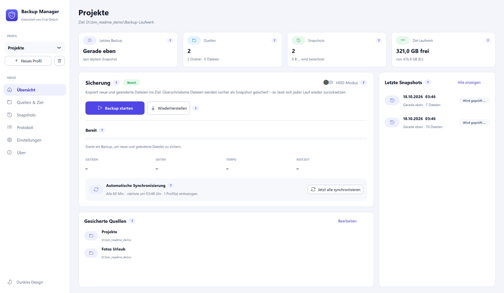
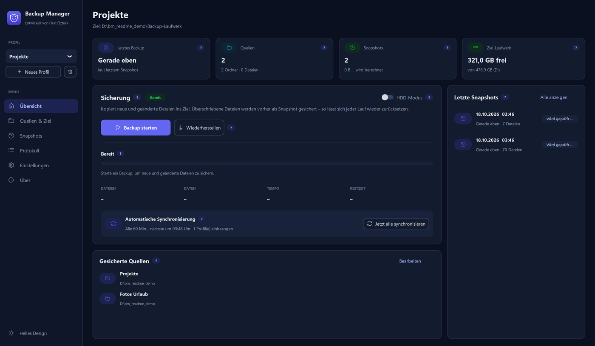
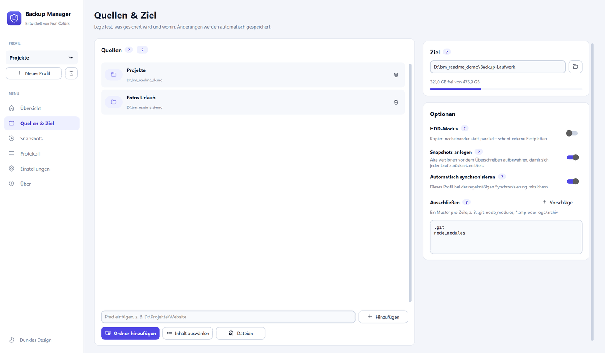
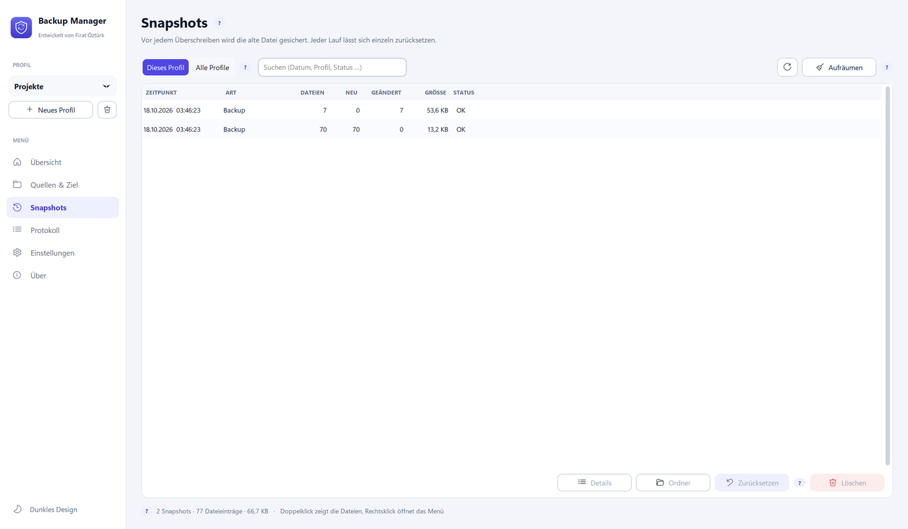
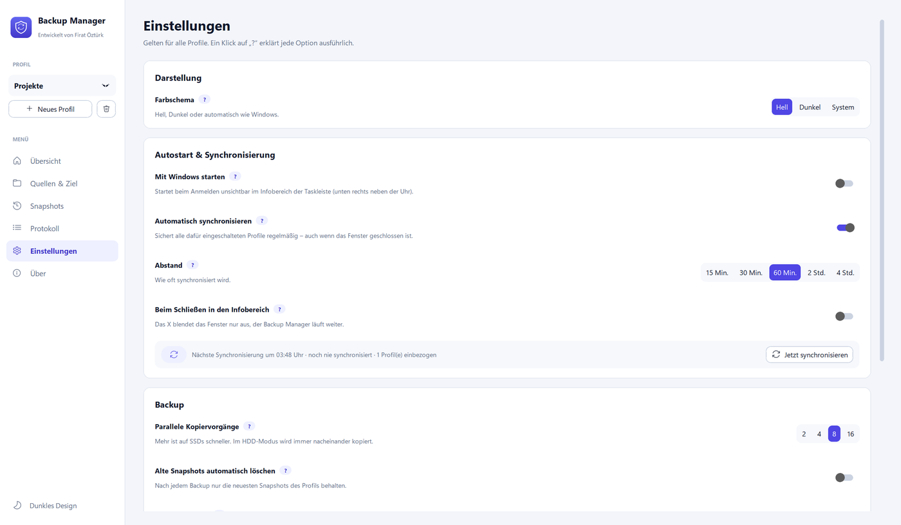
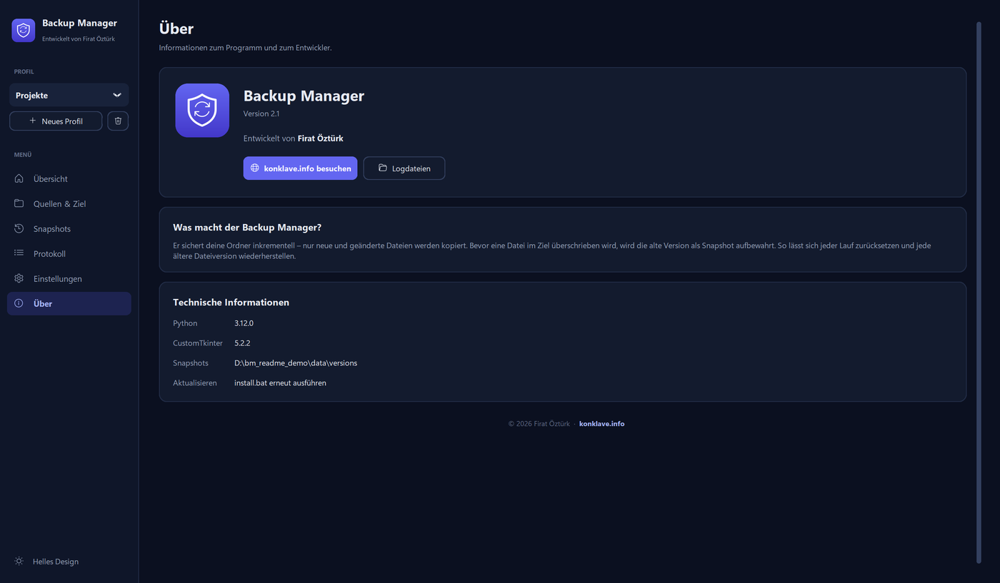

<div align="center">

# 🛡️ Backup Manager

**Inkrementelle Backups für Windows — mit Snapshots, Rollback und automatischer Synchronisierung.**

Kostenlos und quelloffen (MIT-Lizenz) · von [Firat Öztürk](https://konklave.info)

[](../../releases/latest)
[](LICENSE)
[](#installation)
[](#f%C3%BCr-entwicklerinnen)

</div>

---

Der Backup Manager sichert deine Ordner auf Knopfdruck — oder automatisch im Hintergrund — auf eine externe
Festplatte, ein anderes Laufwerk oder ein NAS im Heimnetz. Bevor eine Datei im Ziel überschrieben wird, sichert er die alte Version
als **Snapshot**. So lässt sich jeder einzelne Backup-Lauf später komplett zurücksetzen, und jede frühere
Dateiversion kann gezielt wiederhergestellt werden — ganz ohne Cloud, ohne Abo, ohne Datenabfluss nach außen.

<div align="center">
  
  
</div>

## Inhalt

- [Funktionen](#funktionen)
- [Installation](#installation)
- [Screenshots](#screenshots)
- [Bedienung](#bedienung)
- [Wie es funktioniert](#wie-es-funktioniert)
- [Wo liegen meine Daten?](#wo-liegen-meine-daten)
- [Für Entwickler:innen](#für-entwicklerinnen)
- [Mitwirken](#mitwirken)
- [Lizenz](#lizenz)

## Funktionen

- **Inkrementelles Backup** – es werden nur neue oder geänderte Dateien kopiert, nichts Unnötiges.
- **Snapshots & Rollback** – jede überschriebene Datei wird vorher gesichert; ein kompletter Lauf lässt sich
  mit einem Klick zurücksetzen, einzelne ältere Versionen lassen sich separat speichern.
- **Wiederherstellung** – Dateien vom Backup-Ziel zurück in die Quellordner kopieren, inklusive eigenem Rollback.
- **Beliebig viele Profile** – z. B. eines pro externer Festplatte, mit eigenen Quellen, Ziel, Ausschlüssen
  (`.git`, `node_modules`, `*.tmp`, …) und HDD-Modus (serielles statt paralleles Kopieren für klassische Platten).
- **Automatische Synchronisierung** – läuft optional im Infobereich der Taskleiste und sichert alle dafür
  eingeschalteten Profile in einstellbarem Abstand (15 Min. bis 4 Std.), auch bei geschlossenem Fenster.
- **NAS & Netzwerkfreigaben** – Ziel oder Quelle darf auch eine Freigabe sein (`\\NAS\Backup`,
  `\\192.168.178.20\Backup` oder Netzlaufwerk `Z:`) – getestet für die gängigen Systeme: Synology, QNAP,
  FRITZ!Box, TrueNAS, Unraid, OpenMediaVault, Samba und Windows-Freigaben.
  - Anmeldung direkt im Programm; das Passwort verwahrt nur Windows (Anmeldeinformationsverwaltung).
  - Ein ausgeschaltetes NAS lässt das Fenster nicht hängen; ein Backup wartet bis zu einer Minute, bis das NAS
    aufgewacht ist. Bricht die Verbindung mitten im Lauf ab, wird sauber beendet und beim nächsten Mal fortgesetzt.
  - Systemordner wie `#snapshot`, `#recycle`, `@eaDir`, `@Recently-Snapshot` oder `.zfs` werden übersprungen.
  - Verständliche Meldungen für typische Windows-11-Probleme (Gastzugang gesperrt, nur SMB1, falsches Passwort,
    FAT32-Grenze von 4 GB bei USB-Speicher an der FRITZ!Box).
- **Updates mit einem Klick** – das Programm sieht einmal täglich nach einer neuen Version, lädt sie auf Wunsch,
  prüft ihre Echtheit (SHA-256) und installiert sie. Profile, Einstellungen und Snapshots bleiben erhalten.
- **Autostart** – startet auf Wunsch minimiert mit Windows.
- **Snapshots abschaltbar** – pro Profil wählbar, falls nur eine reine Kopie ohne Versionierung gewünscht ist.
- **Helles/dunkles Design**, folgt auf Wunsch automatisch dem Windows-Farbschema.
- **Ohne Cloud** – deine Daten verlassen nie dein Netz. Ins Internet geht nur die einmalige Installation der
  Python-Komponenten und die tägliche Update-Prüfung bei GitHub (abschaltbar, überträgt keine Daten über dich).

## Installation

### Variante A — Installationsprogramm (empfohlen)

1. Die neueste `BackupManager-Setup-*.exe` von der **[Releases-Seite](../../releases/latest)** herunterladen.
2. Starten. Windows SmartScreen warnt bei unsignierten Programmen – auf **„Weitere Informationen“ →
   „Trotzdem ausführen“** klicken.
3. Der Installer kopiert das Programm standardmäßig nach `%LOCALAPPDATA%\Programs\BackupManager` (pro
   Benutzer, **keine Administratorrechte nötig**), installiert bei Bedarf automatisch Python 3.12 sowie alle
   benötigten Pakete und legt Verknüpfungen an. Über „Ändern …“ lässt sich auch ein anderer Ordner wählen,
   z. B. `C:\Program Files\BackupManager` für alle Benutzer (dafür fragt Windows nach Administratorrechten).

   Ohne Fenster: `BackupManager-Setup.exe /S` (weitere Schalter: `/D=Ordner` `/nodesktop` `/nopin` `/nostart`).

**Update:** Ab Version 2.2 meldet der Backup Manager neue Versionen selbst (Einstellungen → Updates) und installiert
sie mit einem Klick. Alternativ einfach die neue `BackupManager-Setup-*.exe` starten – sie erkennt die vorhandene
Installation und tauscht nur die Programmdateien aus; Profile, Einstellungen und Snapshots bleiben erhalten.

### Variante B — Quellcode (portabel, kein Admin nötig)

```powershell
git clone https://github.com/firo2525/backup-manager.git
cd backup-manager
install.bat
```

`install.bat` sucht ein passendes Python (≥ 3.9), installiert es bei Bedarf automatisch, richtet eine eigene
virtuelle Umgebung (`.venv`) ein und installiert alle Abhängigkeiten. Danach einfach den Ordner
`gui\backup_manager.vbs` starten oder die angebotene Verknüpfung nutzen.

Benötigt wird **Windows 10 oder 11**. Mit einer Internetverbindung für den einmaligen Download von Python und den
Paketen bei der Installation.

## Screenshots

| Quellen & Ziel | Snapshots |
|---|---|
|  |  |

| Einstellungen | Über |
|---|---|
|  |  |

## Bedienung

| Seite | Was man dort macht |
|---|---|
| **Übersicht** | Backup starten/wiederherstellen, Live-Fortschritt, Status der automatischen Synchronisierung |
| **Quellen & Ziel** | Was wird wohin gesichert; HDD-Modus, Snapshots an/aus, Ausschlussmuster |
| **Snapshots** | Alle Läufe mit Größe & Status; Details, Zurücksetzen, Löschen, Aufräumen |
| **Protokoll** | Live-Log mit Filter nach Schweregrad |
| **Einstellungen** | Design, Autostart, Synchronisierungs-Intervall, Speicherort der Snapshots |

Überall erklärt ein kleines **„?“** die jeweilige Funktion ausführlich (Maus darüber, Klick hält es offen).
Tastenkürzel: `Strg+B` Backup starten · `Strg+1…6` Seiten wechseln · `F5` Snapshots neu laden.

## Wie es funktioniert

**Backup** vergleicht jede Quelldatei mit dem Ziel (Größe + Änderungszeit, 2 s Toleranz für FAT/exFAT) und
kopiert nur, was fehlt oder abweicht. Vor jedem Überschreiben wird die alte Zieldatei unter
`versions/<run_id>/…` gesichert und in `metadata.json` vermerkt. Schlägt die Sicherung fehl, bleibt die
Zieldatei unangetastet — es geht nie eine Version verloren.

**Rollback** liest die Metadaten eines Laufs rückwärts: überschriebene Dateien werden aus dem Snapshot
zurückkopiert, neu angelegte Dateien gelöscht.

**Wiederherstellung** kopiert fehlende/abweichende Dateien vom Ziel zurück in die Quellen; in der Quelle
neuere Dateien bleiben standardmäßig erhalten. Auch eine Wiederherstellung erzeugt einen eigenen Snapshot und
ist damit selbst wieder rückgängig machbar.

## Wo liegen meine Daten?

| Installationsart | Programm | Konfiguration, Logs, Snapshots |
|---|---|---|
| Installer (Standard, pro Benutzer) | `%LOCALAPPDATA%\Programs\BackupManager` | im selben Ordner |
| Installer, Ordner `C:\Program Files\...` gewählt | dort | `%LOCALAPPDATA%\BackupManager` |
| Portabel | Dein gewählter Ordner | im selben Ordner (`config`, `logs`, `versions`) |

Der Snapshot-Ordner lässt sich jederzeit unter **Einstellungen → Speicherort der Snapshots** ändern; vorhandene
Snapshots werden dabei automatisch mitverschoben. Es werden keinerlei Daten an externe Server gesendet.

## Für Entwickler:innen

```powershell
.venv\Scripts\python -m pip install -r requirements-dev.txt
.venv\Scripts\python -m pytest
```

Die Tests laufen ausschließlich in temporären Ordnern (`tests/conftest.py`) und fassen keine echten Profile an.

Projektstruktur:

```
engine/            Kernlogik (Backup/Recovery/Snapshots) + engine/ui (CustomTkinter-Oberfläche)
installer/         PyInstaller-Installer (build_installer.bat → dist/BackupManager-Setup-*.exe)
tests/             pytest-Suite
install.bat        Abhängigkeiten prüfen/installieren (auch von installer/setup.py genutzt)
```

Die Installations-EXE selbst baut man mit:

```powershell
installer\build_installer.bat
```

## Mitwirken

Fehler gefunden oder eine Idee? Gerne ein [Issue](../../issues) eröffnen oder direkt einen Pull Request
schicken. Bug-Reports sind am hilfreichsten mit: Windows-Version, was erwartet wurde, was tatsächlich passiert
ist, und – falls vorhanden – der betreffende Ausschnitt aus dem Ordner `logs`.

## Lizenz

[MIT](LICENSE) — frei nutzbar, veränderbar und weiterverteilbar, auch kommerziell.

---

<div align="center">
Entwickelt von <a href="https://konklave.info"><b>Firat Öztürk</b></a>
</div>
